# AprendIA — API REST (SOA e Web Services)

Entrega da disciplina **Arquitetura Orientada a Serviços (SOA) e Web Services** da Global Solution 2026.2 (CitizenTech).

Esta é a camada de backend do AprendIA: uma API REST em Java que recebe os questionários dos alunos, executa o modelo de IA (ONNX) **dentro da própria API, sem Python**, grava os diagnósticos no Oracle e devolve os insights para o professor.

## Sumário

1. [Integrantes](#integrantes)
2. [Ficha da CitizenTech](#ficha-da-citizentech)
3. [O problema e a solução](#o-problema-e-a-solução)
4. [Como o diagnóstico funciona](#como-o-diagnóstico-funciona)
5. [Arquitetura](#arquitetura)
6. [Tecnologias](#tecnologias)
7. [Estrutura do código](#estrutura-do-código)
8. [Domínio](#domínio)
9. [Banco de dados e migrações](#banco-de-dados-e-migrações)
10. [Configuração](#configuração)
11. [Como executar](#como-executar)
12. [Endpoints](#endpoints)
13. [Exemplos de uso](#exemplos-de-uso)
14. [Tratamento de erros](#tratamento-de-erros)
15. [Testes manuais (Insomnia)](#testes-manuais-insomnia)
16. [Integração com o modelo de IA](#integração-com-o-modelo-de-ia)
17. [Dados e privacidade](#dados-e-privacidade)
18. [Problemas comuns](#problemas-comuns)
19. [Evidências](#evidências)

## Integrantes

| Nome | RM |
|---|---|
| Leonardo Fernandes Mesquita | RM:559623 |
| Vitor de Lima Domingues | RM:561008 |
| Giovanni Romano Provazi | RM:560434 |
| Caio Berardo de Araújo | RM:560357 |
| Felipe Carlos Abreu | RM:559476 |

## Ficha da CitizenTech

| Campo | Preenchimento |
|---|---|
| Nome da CitizenTech | *AprendIA* |
| Cidade e bairro | São Paulo |
| Cidadão beneficiado | Alunos do 1º ao 5º ano e seus professores |
| Problema, em uma frase | Professores não têm um jeito rápido e padronizado de saber em quais conteúdos cada aluno está abaixo do esperado para a sua série, nem o que fazer a respeito. |
| Como funciona | O aluno responde a um questionário da sua série (24 questões de Língua Portuguesa e Matemática). A API corrige, o modelo de ML estima a chance de lacuna em cada um dos 8 conteúdos, e a API gera os insights: nível por disciplina, conteúdos a reforçar em ordem de urgência e uma estratégia de estudo para cada um. Casos duvidosos ficam para o professor confirmar. |
| O que cada parte faz | **IA:** modelo treinado e exportado em ONNX, com o contrato de integração. **API Java (este repositório):** cadastro de escolas e alunos, correção, execução do modelo, insights, confirmação do professor e histórico, com persistência no Oracle. |
| Link do repositório | *https://github.com/Stack-Society/gs_SOAeWebServices_2026-27* |
| Indicador de impacto | % de alunos com diagnóstico no início do ano; tempo até a intervenção; % de lacunas superadas no questionário seguinte (histórico do aluno) |
| ODS conectados | ODS 4 (Educação de qualidade) e ODS 10 (Redução das desigualdades) |

## O problema e a solução

**Problema.** No início do ano (ou depois de um período de ensino irregular), o professor dos anos iniciais precisa descobrir, para cada aluno, em quais conteúdos ele está abaixo do esperado para a série. Sem uma ferramenta, isso depende de provas corrigidas à mão e da percepção de cada professor, o que é lento e varia de uma turma para outra.

**Solução.** O AprendIA aplica um questionário curto e padronizado por série e entrega ao professor, em segundos:

- o **nível** do aluno em Língua Portuguesa e em Matemática;
- os **conteúdos com lacuna**, em ordem de urgência;
- uma **estratégia de estudo** para cada conteúdo a reforçar;
- os **casos duvidosos**, que o professor confirma, sem que a IA decida sozinha;
- o **histórico** do aluno, para acompanhar a evolução entre um questionário e outro.

**Papel desta API.** É o serviço que une as partes: guarda o catálogo do questionário, cadastra escolas e alunos, corrige as respostas, executa o modelo de IA, aplica as regras de decisão e grava tudo no banco, expondo cada operação como um endpoint REST.

## Como o diagnóstico funciona

```
POST /alunos/{id}/diagnosticos  { "respostas": { "q1": "B", ..., "q24": "C" } }
  1. Validar      série do aluno (1 a 5) e 24 respostas A/B/C; se não, 400 e nada é gravado
  2. Corrigir     acertos (0 a 3) por conteúdo, com o gabarito da série (tabela GS2627_1_questao)
  3. Modelo       ONNX Runtime: 13 features → probabilidade de lacuna em cada um dos 8 conteúdos
  4. Decidir      a_confirmar se |p − 0,40| < 0,05; senão lacuna se p ≥ 0,40; senão sem_lacuna
  5. Insights     nível por disciplina, conteúdos a reforçar (lacunas primeiro) e estratégia de cada um
  6. Gravar       diagnóstico, 24 respostas, 8 resultados e 2 níveis, numa única transação
```

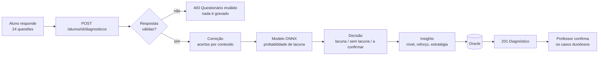

### Conteúdos avaliados

Cada questionário tem 24 questões: 3 para cada um dos 8 conteúdos.

| Disciplina | Conteúdo (código) | Nome | Ordem no modelo |
|---|---|---|---|
| Língua Portuguesa | `decodificacao` | Decodificação | 0 |
| Língua Portuguesa | `localizar_informacao` | Localizar informação | 1 |
| Língua Portuguesa | `inferencia` | Inferência | 2 |
| Língua Portuguesa | `ortografia` | Ortografia | 3 |
| Matemática | `numeros` | Números | 4 |
| Matemática | `operacoes` | Operações | 5 |
| Matemática | `geometria` | Geometria | 6 |
| Matemática | `grandezas_medidas` | Grandezas e medidas | 7 |

### Regras de decisão

**Situação de cada conteúdo** (limiar 0,40 e margem 0,05, configuráveis no `application.properties`):

| Probabilidade de lacuna (p) | Situação |
|---|---|
| 0,35 < p < 0,45 (muito perto do limiar) | `a_confirmar`: o professor decide |
| p ≥ 0,45 | `lacuna` |
| p ≤ 0,35 | `sem_lacuna` |

**Nível de cada disciplina** (4 conteúdos por disciplina):

| Lacunas | Nível | Orientação |
|---|---|---|
| 0 | adequado | Manter a rotina de estudo e propor desafios um pouco acima da série. |
| 1 a 2 | em desenvolvimento | Reforçar os conteúdos indicados com 15 a 20 minutos de prática, 3 vezes por semana, e rever o progresso em 1 mês. |
| 3 a 4 | abaixo do esperado | Priorizar os 2 conteúdos mais urgentes por vez, com acompanhamento semanal do professor e envolvimento da família; refazer o questionário em 1 mês. |
| — | a confirmar | Há conteúdos com resultado duvidoso: o professor deve avaliá-los antes de definir o plano. |

O nível fica **a confirmar** quando os conteúdos duvidosos podem mudar o resultado: a API calcula o nível no melhor caso (nenhuma dúvida é lacuna) e no pior caso (todas as dúvidas são lacunas). Se os dois forem iguais, as dúvidas não importam e o nível é definido; se forem diferentes, o professor precisa confirmar.

**Conteúdos a reforçar:** primeiro as lacunas, depois os "a confirmar"; dentro de cada grupo, da maior para a menor probabilidade.

**Confirmação do professor:** o professor decide cada conteúdo "a confirmar" como `lacuna` ou `sem_lacuna`. A decisão do modelo continua gravada (para auditoria), a do professor fica em colunas próprias, e o nível da disciplina é recalculado com a decisão final. Conteúdos que o modelo já decidiu não podem ser confirmados (409).

## Arquitetura

O código é organizado **por funcionalidade**: cada pacote reúne a entidade, os DTOs, o repositório e o service de uma parte do sistema. Os controllers ficam juntos em `controller/`, e as exceções, compartilhadas por todos, em `exception/`. Dentro de cada funcionalidade, as responsabilidades continuam separadas em camadas: o controller recebe a requisição, o service aplica as regras e o repositório acessa o banco.

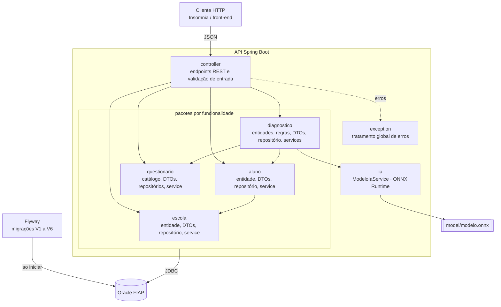

| Pacote | Responsabilidade |
|---|---|
| `controller` | Recebe as requisições HTTP, valida o corpo com Bean Validation (`@Valid`), aplica a paginação das listagens e devolve o status correto (200, 201, 204). Inclui o `HealthCheckController`. |
| `escola` | Cadastro de escolas: entidade `Escola`, DTOs, `EscolaRepository` e `EscolaService`. |
| `aluno` | Cadastro de alunos: entidade `Aluno`, DTOs, `AlunoRepository` e `AlunoService`. |
| `questionario` | Catálogo do questionário (`Disciplina`, `Conteudo`, `Questao`), seus repositórios, os DTOs e o `QuestionarioService`. |
| `diagnostico` | Entidades do diagnóstico, enums com as regras de decisão (`Situacao`, `NivelDisciplina`), DTOs, `DiagnosticoRepository` e os services de correção, insights e do fluxo completo. A confirmação do professor e o recálculo do nível ficam na entidade `Diagnostico`. |
| `ia` | `ModeloIaService`, que carrega e executa o modelo ONNX. |
| `exception` | Exceções da aplicação, o `ErroResponse` e o `ApiExceptionHandler`, que converte cada exceção em uma resposta de erro padronizada. |

**Padrões de código usados:**

- **Lombok nas entidades:** `@Getter`, `@NoArgsConstructor`, `@AllArgsConstructor` e `@EqualsAndHashCode(of = "id")` geram getters, construtores, `equals` e `hashCode` em tempo de compilação. Métodos com regra própria, como as listas somente leitura do `Diagnostico`, continuam escritos à mão.
- **DTOs como records com construtor de conversão:** cada DTO de resposta tem um construtor que recebe a entidade (por exemplo, `new AlunoResponse(aluno)` ou `.map(AlunoResponse::new)`). A API nunca expõe as entidades diretamente; o gabarito, por exemplo, nunca sai na resposta.
- **Injeção de dependências com `@Autowired`** nos campos dos controllers e services, e `@Value` para os parâmetros do `application.properties`.
- **Paginação do Spring Data** (`Page`, `Pageable` e `@PageableDefault`) nas listagens de escolas e alunos.
- **Transações** (`@Transactional`) em todos os services: o diagnóstico é gravado inteiro ou não é gravado.

**Princípios de SOA aplicados:**

- **Contrato bem definido:** cada recurso tem URL, método e formato de JSON fixos, documentados aqui e na coleção do Insomnia.
- **Baixo acoplamento:** quem consome a API não precisa saber que o modelo é ONNX nem que o banco é Oracle.
- **Serviço sem estado:** cada requisição traz tudo o que precisa; o estado fica só no banco.
- **Reutilização:** o mesmo serviço de diagnóstico atende a qualquer cliente (app, site ou outro sistema).
- **Recursos aninhados:** os diagnósticos ficam sob o aluno (`/alunos/{id}/diagnosticos`), o que deixa claro a quem pertencem e impede consultar o diagnóstico de outro aluno.

## Tecnologias

| Tecnologia | Versão | Uso |
|---|---|---|
| Java | 25 | Linguagem |
| Spring Boot | 4.1.2 | Base da aplicação |
| Spring Web MVC | (Spring Boot) | API REST e servidor Tomcat embutido |
| Bean Validation | (Spring Boot) | Validação dos dados de entrada |
| Spring Data JPA / Hibernate | (Spring Boot) | Persistência, paginação e mapeamento objeto-relacional (`ddl-auto=validate`) |
| Flyway | (Spring Boot) | Migrações versionadas do banco |
| Lombok | (Spring Boot) | Geração de getters, construtores, `equals` e `hashCode` nas entidades |
| Spring Boot DevTools | (Spring Boot) | Reinício automático da aplicação durante o desenvolvimento |
| Oracle Database | 19 (FIAP) | Banco de dados |
| Oracle JDBC (`ojdbc11`) | (Spring Boot) | Driver de conexão |
| ONNX Runtime | 1.32.0 | Execução do modelo de IA dentro da API |
| Spring Boot WebMVC Test | (Spring Boot) | Base para testes automatizados (JUnit 5, MockMvc) |
| Maven (wrapper) | — | Build e dependências |
| Insomnia | — | Testes manuais |

## Estrutura do código

O código-fonte está todo comentado, linha a linha, para facilitar a leitura e a manutenção.

```
src/main/java/br/com/fiap3espa/api
├── ApiApplication.java                ponto de entrada (Spring Boot)
├── controller/                        endpoints REST
│   ├── HealthCheckController          GET /healthcheck
│   ├── QuestionarioController         GET /questionarios/{serie}
│   ├── EscolaController               CRUD /escolas (listagem paginada)
│   ├── AlunoController                CRUD /alunos (listagem paginada)
│   └── DiagnosticoController          /alunos/{alunoId}/diagnosticos
├── escola/
│   ├── Escola                         entidade
│   ├── EscolaRequest, EscolaAtualizacaoRequest, EscolaResponse   DTOs
│   ├── EscolaRepository               acesso ao banco
│   └── EscolaService                  regras do CRUD de escolas
├── aluno/
│   ├── Aluno                          entidade
│   ├── AlunoRequest, AlunoAtualizacaoRequest, AlunoResponse      DTOs
│   ├── AlunoRepository                acesso ao banco
│   └── AlunoService                   regras do CRUD de alunos
├── questionario/
│   ├── Disciplina, Conteudo, Questao  catálogo (entidades somente leitura)
│   ├── QuestaoResponse, QuestionarioResponse                      DTOs
│   ├── DisciplinaRepository, ConteudoRepository, QuestaoRepository
│   └── QuestionarioService            monta o questionário (sem gabarito)
├── diagnostico/
│   ├── Diagnostico, Resposta, DiagnosticoConteudo, DiagnosticoDisciplina   entidades
│   ├── Situacao, NivelDisciplina      enums com as regras de decisão
│   ├── DiagnosticoRequest, ConfirmacaoRequest, DiagnosticoResponse, DiagnosticoResumoResponse   DTOs
│   ├── DiagnosticoRepository          acesso ao banco
│   ├── CorrecaoService                validação e correção das respostas
│   ├── InsightService                 decisão de cada conteúdo, níveis e reforço
│   ├── DiagnosticoService             fluxo completo, consulta, confirmação e histórico
│   └── AcertoConteudo, ResultadoConteudo, ResultadoDisciplina, Insights   records internos
├── ia/
│   └── ModeloIaService                execução do modelo ONNX
└── exception/                         exceções, ErroResponse e tratamento global de erros (400, 404, 409)

src/main/resources
├── application.properties             porta, conexão, Flyway e parâmetros do modelo (limiar, margem, versão)
├── db/migration/                      migrações V1 a V6
└── model/modelo.onnx                  modelo de IA treinado

insomnia/aprendia-insomnia.json        coleção de testes manuais
TESTES.md                              roteiro dos testes, com os valores esperados
```

## Domínio

### Modelo de dados

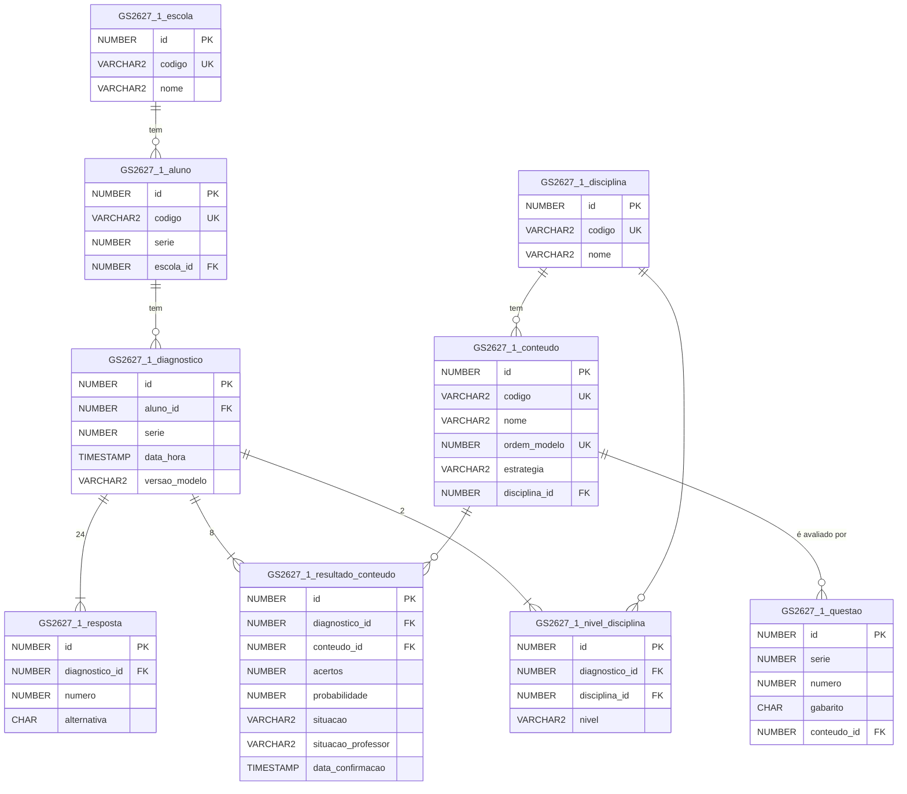

### Entidades

| Entidade | Tabela | Descrição |
|---|---|---|
| `Disciplina` | `GS2627_1_disciplina` | Língua Portuguesa e Matemática (somente leitura). |
| `Conteudo` | `GS2627_1_conteudo` | Os 8 conteúdos, com a posição no vetor do modelo (`ordem_modelo`) e a estratégia de estudo (somente leitura). |
| `Questao` | `GS2627_1_questao` | As 24 questões de cada série, com gabarito e conteúdo avaliado (somente leitura). |
| `Escola` | `GS2627_1_escola` | Escola dos alunos; o código não muda depois do cadastro. |
| `Aluno` | `GS2627_1_aluno` | Identificado só por código anônimo; tem série e escola. |
| `Diagnostico` | `GS2627_1_diagnostico` | Um questionário respondido: série usada, data e versão do modelo. É a raiz do agregado: respostas, resultados e níveis são gravados junto com ele (cascade). |
| `Resposta` | `GS2627_1_resposta` | Alternativa marcada em cada questão. |
| `DiagnosticoConteudo` | `GS2627_1_resultado_conteudo` | Acertos, probabilidade de lacuna, decisão do modelo e, se houver, decisão do professor. |
| `DiagnosticoDisciplina` | `GS2627_1_nivel_disciplina` | Nível do aluno em cada disciplina. |

| Enum | Valores |
|---|---|
| `Situacao` | `LACUNA`, `SEM_LACUNA`, `A_CONFIRMAR` |
| `NivelDisciplina` | `ADEQUADO`, `EM_DESENVOLVIMENTO`, `ABAIXO_DO_ESPERADO`, `A_CONFIRMAR` (cada um com sua orientação) |

Todas as entidades seguem o mesmo padrão de anotações:

```java
@Entity(name = "Aluno")                 // entidade JPA
@Table(name = "GS2627_1_aluno")         // tabela criada pelo Flyway
@NoArgsConstructor                      // Lombok: construtor vazio exigido pelo JPA
@AllArgsConstructor                     // Lombok: construtor com todos os campos
@Getter                                 // Lombok: getters
@EqualsAndHashCode(of = "id")           // Lombok: igualdade pelo id
public class Aluno { ... }
```

### Regras de integridade

As regras são garantidas em duas camadas: na API (validação e exceções) e no banco (restrições):

- códigos de escola, aluno, disciplina e conteúdo são **únicos** (`UNIQUE`);
- série entre 1 e 5, número da questão entre 1 e 24, alternativa A/B/C, acertos entre 0 e 3 e probabilidade entre 0 e 1 (`CHECK`);
- uma resposta por questão e um resultado por conteúdo em cada diagnóstico (`UNIQUE` composto);
- a situação do professor só pode existir se o modelo deixou o conteúdo "a confirmar", e a data da confirmação só existe junto com ela (`CHECK`);
- não é possível excluir uma escola com alunos nem um aluno com diagnósticos (409 na API e chave estrangeira no banco);
- ao excluir um diagnóstico, as respostas, os resultados e os níveis são excluídos junto (`ON DELETE CASCADE`).

## Banco de dados e migrações

Todas as tabelas usam o prefixo `GS2627_1_`. O esquema é criado **somente pelo Flyway**; o Hibernate apenas valida as entidades contra as tabelas (`ddl-auto=validate`), então qualquer diferença entre o código e o banco impede a aplicação de subir.

| Migração | Arquivo | O que faz |
|---|---|---|
| V1 | `V1__criar_catalogo.sql` | Cria o catálogo: `disciplina`, `conteudo` (com a ordem usada pelo modelo) e `questao` |
| V2 | `V2__popular_disciplinas_conteudos.sql` | Insere as 2 disciplinas e os 8 conteúdos, com a estratégia de estudo de cada um |
| V3 | `V3__popular_questoes.sql` | Insere as 120 questões (24 por série) com gabarito |
| V4 | `V4__criar_escola_aluno.sql` | Cria `escola` e `aluno` (aluno identificado só por código anônimo) |
| V5 | `V5__criar_diagnostico.sql` | Cria `diagnostico`, `resposta`, `resultado_conteudo` e `nivel_disciplina` |
| V6 | `V6__confirmacao_professor.sql` | Adiciona a confirmação do professor em `resultado_conteudo` |

- Os dados das V2 e V3 vêm do contrato do modelo (`modelo_info.json`).
- O esquema do usuário Oracle já tinha outras tabelas, por isso o Flyway usa *baseline* na versão 0 e aplica as migrações a partir da V1.
- As migrações são executadas automaticamente toda vez que a API sobe; as que já foram aplicadas são ignoradas.
- Uma migração já aplicada **não deve ser editada**: o Flyway confere o checksum de cada arquivo e recusa a subida se ele mudar. Alterações no banco entram sempre como uma nova versão (V7, V8...).

Para conferir as migrações aplicadas:

```sql
SELECT version, description, success FROM "flyway_schema_history" ORDER BY installed_rank;
```

Para conferir o catálogo:

```sql
SELECT COUNT(*) FROM GS2627_1_disciplina;   -- 2
SELECT COUNT(*) FROM GS2627_1_conteudo;     -- 8
SELECT COUNT(*) FROM GS2627_1_questao;      -- 120
```

## Configuração

Arquivo `src/main/resources/application.properties`:

| Propriedade | Valor | Descrição |
|---|---|---|
| `server.port` | `8080` | Porta HTTP da API |
| `spring.datasource.url` | `${DB_URL:jdbc:oracle:thin:@oracle.fiap.com.br:1521:ORCL}` | URL do banco; usa `DB_URL` se existir |
| `spring.datasource.username` | `${DB_USERNAME}` | Usuário do banco (variável de ambiente) |
| `spring.datasource.password` | `${DB_PASSWORD}` | Senha do banco (variável de ambiente) |
| `spring.jpa.hibernate.ddl-auto` | `validate` | Hibernate só valida; quem cria o esquema é o Flyway |
| `spring.flyway.locations` | `classpath:db/migration` | Pasta das migrações |
| `spring.flyway.baseline-on-migrate` | `true` | Aceita um esquema que já tem outras tabelas |
| `spring.flyway.baseline-version` | `0` | Aplica as migrações a partir da V1 |
| `aprendia.modelo.limiar-lacuna` | `0.40` | Probabilidade a partir da qual o conteúdo é lacuna |
| `aprendia.modelo.margem-duvida` | `0.05` | Distância do limiar em que o conteúdo fica "a confirmar" |
| `aprendia.modelo.versao` | `2.0` | Versão do modelo, gravada em cada diagnóstico |

## Como executar

### Pré-requisitos

- JDK 25, com `JAVA_HOME` configurado e `%JAVA_HOME%\bin` no `Path`
- Acesso ao Oracle da FIAP (`oracle.fiap.com.br:1521`)
- Não é preciso instalar o Maven: o projeto usa o Maven Wrapper (`mvnw`)

### Credenciais

O usuário e a senha do banco **não ficam no código**: a API lê as variáveis de ambiente `DB_USERNAME` e `DB_PASSWORD` (e, opcionalmente, `DB_URL`).

### Subir a API

PowerShell (Windows), na pasta do projeto:

```powershell
$env:DB_USERNAME = "seu_usuario"; $env:DB_PASSWORD = "sua_senha"; .\mvnw.cmd spring-boot:run
```

Bash (Linux, macOS ou Git Bash no Windows), na pasta do projeto:

```bash
DB_USERNAME=seu_usuario DB_PASSWORD=sua_senha ./mvnw spring-boot:run
```

A API sobe em `http://localhost:8080`. Na primeira execução, o Flyway cria as tabelas e insere o catálogo.

### Gerar o .jar

O teste automático `ApiApplicationTests` sobe a aplicação inteira e precisa do banco; para gerar o pacote sem ele:

PowerShell:

```powershell
.\mvnw.cmd clean package -DskipTests
```

Bash:

```bash
./mvnw clean package -DskipTests
```

Para executar o .jar gerado:

PowerShell:

```powershell
$env:DB_USERNAME = "seu_usuario"; $env:DB_PASSWORD = "sua_senha"; java -jar target\api-0.0.1-SNAPSHOT.jar
```

Bash:

```bash
DB_USERNAME=seu_usuario DB_PASSWORD=sua_senha java -jar target/api-0.0.1-SNAPSHOT.jar
```

### Conferir se subiu

```
GET http://localhost:8080/healthcheck
```

Deve responder 200 com o texto `Teste de integridade da API AprendIA.`. Para conferir também o banco:

```
GET http://localhost:8080/questionarios/1
```

Deve responder 200 com as 24 questões do 1º ano.

## Endpoints

| Método | URL | Descrição | Respostas |
|---|---|---|---|
| GET | `/healthcheck` | Confere se a API está no ar | 200 |
| GET | `/questionarios/{serie}` | 24 questões da série, sem gabarito | 200 · 400 |
| GET | `/escolas` | Lista escolas (paginado) | 200 |
| GET | `/escolas/{id}` | Busca escola | 200 · 404 |
| POST | `/escolas` | Cadastra escola | 201 · 400 · 409 |
| PUT | `/escolas/{id}` | Atualiza o nome | 200 · 400 · 404 |
| DELETE | `/escolas/{id}` | Exclui escola sem alunos | 204 · 404 · 409 |
| GET | `/alunos` | Lista alunos (paginado) | 200 |
| GET | `/alunos/{id}` | Busca aluno | 200 · 404 |
| POST | `/alunos` | Cadastra aluno | 201 · 400 · 404 · 409 |
| PUT | `/alunos/{id}` | Atualiza série e escola | 200 · 400 · 404 |
| DELETE | `/alunos/{id}` | Exclui aluno sem diagnósticos | 204 · 404 · 409 |
| POST | `/alunos/{id}/diagnosticos` | Corrige, executa o modelo e grava o diagnóstico | 201 · 400 · 404 |
| GET | `/alunos/{id}/diagnosticos` | Histórico resumido do aluno | 200 · 404 |
| GET | `/alunos/{id}/diagnosticos/{diagnosticoId}` | Diagnóstico completo | 200 · 404 |
| PATCH | `/alunos/{id}/diagnosticos/{diagnosticoId}/conteudos/{conteudo}` | Confirmação do professor | 200 · 400 · 404 · 409 |

Os POST respondem **201 Created** com o cabeçalho `Location` apontando para o recurso criado (por exemplo, `Location: http://localhost:8080/alunos/1`). Os DELETE respondem **204 No Content**.

### Paginação

`GET /escolas` e `GET /alunos` devolvem uma página do Spring Data. Sem parâmetros na URL, vêm a página 0, com 10 registros, ordenados por `codigo` (`@PageableDefault(size = 10, sort = "codigo")`). A página, o tamanho e a ordenação podem ser escolhidos na URL:

| Parâmetro | Exemplo | Efeito |
|---|---|---|
| `page` | `?page=1` | Número da página, começando em 0 |
| `size` | `?size=5` | Quantidade de registros por página |
| `sort` | `?sort=codigo,desc` | Campo e direção da ordenação |

```http
GET /escolas?page=0&size=1&sort=codigo,desc
```

```json
{
  "content": [ { "id": 1, "codigo": "E01", "nome": "EMEF Exemplo - Unidade Centro" } ],
  "totalElements": 1,
  "totalPages": 1,
  "size": 1,
  "number": 0,
  "first": true,
  "last": true
}
```

(resumido: a resposta também traz `pageable`, `sort`, `numberOfElements` e `empty`)

### Corpos das requisições

| Endpoint | Corpo | Regras |
|---|---|---|
| `POST /escolas` | `{"codigo": "E01", "nome": "EMEF Exemplo"}` | `codigo` obrigatório, até 20 caracteres, único; `nome` obrigatório, até 100 |
| `PUT /escolas/{id}` | `{"nome": "Novo nome"}` | `nome` obrigatório, até 100 caracteres; o código não muda |
| `POST /alunos` | `{"codigo": "A03503", "serie": 4, "escolaId": 1}` | `codigo` obrigatório, até 20, único; `serie` de 1 a 5; `escolaId` de uma escola existente |
| `PUT /alunos/{id}` | `{"serie": 5, "escolaId": 1}` | `serie` de 1 a 5; `escolaId` existente; o código não muda |
| `POST /alunos/{id}/diagnosticos` | `{"respostas": {"q1": "A", ..., "q24": "B"}}` | exatamente as chaves `q1` a `q24`, cada uma com `A`, `B` ou `C` |
| `PATCH .../conteudos/{conteudo}` | `{"situacao": "lacuna"}` | `lacuna` ou `sem_lacuna`; só para conteúdos "a confirmar" |

## Exemplos de uso

### 1. Cadastrar escola e aluno

```http
POST /escolas
{"codigo": "E01", "nome": "EMEF Exemplo"}
```

```http
POST /alunos
{"codigo": "A03503", "serie": 4, "escolaId": 1}
```

### 2. Buscar o questionário da série

```http
GET /questionarios/4
```

```json
{
  "serie": 4,
  "totalQuestoes": 24,
  "questoes": [
    { "numero": 1, "conteudo": "decodificacao", "conteudoNome": "Decodificação", "disciplina": "Língua Portuguesa" }
  ]
}
```

(resumido: a lista traz as 24 questões; o gabarito nunca é devolvido)

### 3. Enviar as respostas e receber o diagnóstico

Requisição (`POST /alunos/1/diagnosticos`, aluno do 4º ano):

```json
{ "respostas": { "q1": "A", "q2": "A", "q3": "B", "q4": "B", "q5": "C", "q6": "C", "q7": "B", "q8": "A",
                 "q9": "A", "q10": "C", "q11": "B", "q12": "C", "q13": "C", "q14": "C", "q15": "C", "q16": "C",
                 "q17": "C", "q18": "A", "q19": "B", "q20": "C", "q21": "A", "q22": "B", "q23": "C", "q24": "B" } }
```

Resposta (resumida):

```json
{
  "id": 1, "aluno": "A03503", "serie": 4, "versaoModelo": "2.0",
  "mensagem": "4 lacuna(s) encontrada(s).",
  "disciplinas": [
    { "disciplina": "portugues", "nivel": "em desenvolvimento", "lacunas": ["localizar_informacao", "inferencia"], "aConfirmar": [] },
    { "disciplina": "matematica", "nivel": "a confirmar", "lacunas": ["numeros", "operacoes"], "aConfirmar": ["geometria", "grandezas_medidas"] }
  ],
  "conteudos": [ { "conteudo": "decodificacao", "acertos": 3, "probabilidade": 0.226029, "situacao": "sem_lacuna", "situacaoFinal": "sem_lacuna" } ],
  "reforcar": [ { "conteudo": "operacoes", "situacao": "lacuna", "probabilidade": 0.827467, "estrategia": "Resolver poucos problemas por dia, ..." } ]
}
```

Campos da resposta:

| Campo | Descrição |
|---|---|
| `id`, `aluno`, `serie`, `dataHora`, `versaoModelo` | Identificação do diagnóstico |
| `mensagem` | Resumo com a quantidade de lacunas |
| `disciplinas[]` | Nível e orientação de cada disciplina, com as listas `lacunas` e `aConfirmar` |
| `conteudos[]` | Os 8 conteúdos na ordem do modelo: `acertos`, `probabilidade`, `situacao` (modelo), `situacaoProfessor` (ou `null`) e `situacaoFinal` (a que vale) |
| `reforcar[]` | Conteúdos a reforçar em ordem de urgência, com a estratégia de estudo |

### 4. Professor confirma os casos duvidosos

```http
PATCH /alunos/1/diagnosticos/1/conteudos/geometria
{"situacao": "lacuna"}
```

Responde 200 com o diagnóstico atualizado: `situacaoProfessor` e `situacaoFinal` mudam no conteúdo confirmado, e o nível de Matemática é recalculado.

### 5. Acompanhar o histórico

```http
GET /alunos/1/diagnosticos
```

Devolve uma linha por diagnóstico (do mais recente para o mais antigo) com data, série, quantidade de lacunas, quantidade "a confirmar" e o nível de cada disciplina.

## Tratamento de erros

Todos os erros seguem o mesmo formato:

```json
{ "status": 400, "mensagem": "Questionário inválido", "detalhes": ["q1: resposta inválida 'D'"], "dataHora": "..." }
```

| Status | Quando acontece | Exemplo de `mensagem` |
|---|---|---|
| 400 | Campo obrigatório ausente, tamanho ou faixa inválidos | `Dados inválidos` (com um detalhe por campo) |
| 400 | Questionário com resposta fora de A/B/C, questão em branco ou chave desconhecida | `Questionário inválido` (com um detalhe por problema) |
| 400 | Série fora de 1 a 5 em `/questionarios/{serie}` | — |
| 404 | Escola, aluno, diagnóstico ou conteúdo inexistente | `Aluno 999999 não encontrado` |
| 409 | Código repetido, exclusão de registro em uso ou confirmação de conteúdo já decidido | `Já existe escola com o código E01` |

A validação do questionário é de **falha fechada**: qualquer problema recusa o questionário inteiro e nada é gravado.

## Testes manuais (Insomnia)

Importe `insomnia/aprendia-insomnia.json` no Insomnia (**Import** → arquivo). A coleção tem 34 requisições em 6 pastas (health check, questionário, escolas, alunos, diagnósticos e exclusões), cobrindo os casos de sucesso e de erro; o status esperado está no nome de cada requisição.

Os ids são gerados pelo banco: depois de criar a escola, o aluno e o diagnóstico, ajuste as variáveis `escola_id`, `aluno_id` e `diagnostico_id` do *Base Environment* com os ids devolvidos. Execute as pastas na ordem em que aparecem.

### Testes da coleção

Os 31 testes originais da coleção foram executados no Insomnia e **passaram** (status e respostas conforme o esperado). Depois disso, o código foi reorganizado (pacotes por funcionalidade, Lombok, `@Autowired`), as listagens passaram a ser paginadas e entraram 3 testes novos (32 a 34). Os testes marcados com ⏳ ainda precisam ser executados nesta versão; recomenda-se executar a coleção inteira de novo. Os valores esperados de cada caso, campo a campo, estão no roteiro [TESTES.md](TESTES.md).

Nas URLs e nos corpos, `{escola_id}`, `{aluno_id}` e `{diagnostico_id}` são as variáveis do *Base Environment*.

| # | Pasta | Teste | Método | URL | Corpo enviado | Status esperado | Resultado |
|---|---|---|---|---|---|---|---|
| 1 | Questionário | Questionário do 3º ano | GET | `/questionarios/3` | — | 200 | ✅ |
| 2 | Questionário | Série inexistente | GET | `/questionarios/9` | — | 400 | ✅ |
| 3 | Escolas | Criar escola | POST | `/escolas` | `{"codigo": "E01", "nome": "EMEF Exemplo"}` | 201 | ✅ |
| 4 | Escolas | Criar escola com código repetido | POST | `/escolas` | `{"codigo": "E01", "nome": "Outra escola"}` | 409 | ✅ |
| 5 | Escolas | Criar escola sem nome | POST | `/escolas` | `{"codigo": "E02", "nome": ""}` | 400 | ✅ |
| 6 | Escolas | Listar escolas | GET | `/escolas` | — | 200 | ⏳ |
| 7 | Escolas | Buscar escola | GET | `/escolas/{escola_id}` | — | 200 | ✅ |
| 8 | Escolas | Buscar escola inexistente | GET | `/escolas/999999` | — | 404 | ✅ |
| 9 | Escolas | Atualizar escola | PUT | `/escolas/{escola_id}` | `{"nome": "EMEF Exemplo - Unidade Centro"}` | 200 | ✅ |
| 10 | Alunos | Criar aluno do 4º ano | POST | `/alunos` | `{"codigo": "A03503", "serie": 4, "escolaId": {escola_id}}` | 201 | ✅ |
| 11 | Alunos | Criar aluno com código repetido | POST | `/alunos` | `{"codigo": "A03503", "serie": 4, "escolaId": {escola_id}}` | 409 | ✅ |
| 12 | Alunos | Criar aluno com série inválida | POST | `/alunos` | `{"codigo": "A99999", "serie": 9, "escolaId": {escola_id}}` | 400 | ✅ |
| 13 | Alunos | Criar aluno em escola inexistente | POST | `/alunos` | `{"codigo": "A99998", "serie": 3, "escolaId": 999999}` | 404 | ✅ |
| 14 | Alunos | Listar alunos | GET | `/alunos` | — | 200 | ⏳ |
| 15 | Alunos | Buscar aluno | GET | `/alunos/{aluno_id}` | — | 200 | ✅ |
| 16 | Alunos | Buscar aluno inexistente | GET | `/alunos/999999` | — | 404 | ✅ |
| 17 | Alunos | Atualizar aluno | PUT | `/alunos/{aluno_id}` | `{"serie": 4, "escolaId": {escola_id}}` | 200 | ✅ |
| 18 | Diagnósticos | Diagnosticar - golden test A03503 | POST | `/alunos/{aluno_id}/diagnosticos` | respostas do golden test A03503 | 201 | ✅ |
| 19 | Diagnósticos | Questionário com resposta inválida | POST | `/alunos/{aluno_id}/diagnosticos` | golden test A03503 com `q1` = "D" | 400 | ✅ |
| 20 | Diagnósticos | Questionário com questão em branco | POST | `/alunos/{aluno_id}/diagnosticos` | golden test A03503 com `q5` = "" | 400 | ✅ |
| 21 | Diagnósticos | Diagnosticar aluno inexistente | POST | `/alunos/999999/diagnosticos` | respostas do golden test A03503 | 404 | ✅ |
| 22 | Diagnósticos | Histórico do aluno | GET | `/alunos/{aluno_id}/diagnosticos` | — | 200 | ✅ |
| 23 | Diagnósticos | Buscar diagnóstico | GET | `/alunos/{aluno_id}/diagnosticos/{diagnostico_id}` | — | 200 | ✅ |
| 24 | Diagnósticos | Buscar diagnóstico inexistente | GET | `/alunos/{aluno_id}/diagnosticos/999999` | — | 404 | ✅ |
| 25 | Diagnósticos | Professor confirma geometria como lacuna | PATCH | `/alunos/{aluno_id}/diagnosticos/{diagnostico_id}/conteudos/geometria` | `{"situacao": "lacuna"}` | 200 | ✅ |
| 26 | Diagnósticos | Professor confirma grandezas_medidas sem lacuna | PATCH | `/alunos/{aluno_id}/diagnosticos/{diagnostico_id}/conteudos/grandezas_medidas` | `{"situacao": "sem_lacuna"}` | 200 | ✅ |
| 27 | Diagnósticos | Confirmar conteúdo já decidido pelo modelo | PATCH | `/alunos/{aluno_id}/diagnosticos/{diagnostico_id}/conteudos/numeros` | `{"situacao": "sem_lacuna"}` | 409 | ✅ |
| 28 | Diagnósticos | Confirmar com situação inválida | PATCH | `/alunos/{aluno_id}/diagnosticos/{diagnostico_id}/conteudos/geometria` | `{"situacao": "talvez"}` | 400 | ✅ |
| 29 | Exclusões | Excluir escola com alunos | DELETE | `/escolas/{escola_id}` | — | 409 | ✅ |
| 30 | Exclusões | Excluir aluno com diagnósticos | DELETE | `/alunos/{aluno_id}` | — | 409 | ✅ |
| 31 | Exclusões | Excluir aluno inexistente | DELETE | `/alunos/999999` | — | 404 | ✅ |
| 32 | Health check | Health check | GET | `/healthcheck` | — | 200 | ⏳ |
| 33 | Escolas | Listar escolas - página com 1 item | GET | `/escolas?page=0&size=1&sort=codigo,desc` | — | 200 | ⏳ |
| 34 | Alunos | Listar alunos - página com 1 item | GET | `/alunos?page=0&size=1` | — | 200 | ⏳ |

Legenda: ✅ passou · ⏳ executar nesta versão.

Corpo dos testes de diagnóstico ("respostas do golden test A03503", aluno do 4º ano):

```json
{"respostas": {"q1": "A", "q2": "A", "q3": "B", "q4": "B", "q5": "C", "q6": "C", "q7": "B", "q8": "A", "q9": "A", "q10": "C", "q11": "B", "q12": "C", "q13": "C", "q14": "C", "q15": "C", "q16": "C", "q17": "C", "q18": "A", "q19": "B", "q20": "C", "q21": "A", "q22": "B", "q23": "C", "q24": "B"}}
```

### Cobertura

| Área | Casos cobertos |
|---|---|
| Health check | API no ar |
| Questionário | série válida e série inexistente |
| Escolas | criar, listar (página padrão e página escolhida na URL), buscar, atualizar, código repetido, campo vazio, inexistente |
| Alunos | criar, listar (página padrão e página escolhida na URL), buscar, atualizar, código repetido, série inválida, escola inexistente, inexistente |
| Diagnósticos | diagnóstico completo, resposta inválida, questão em branco, aluno inexistente, histórico, busca, inexistente |
| Confirmação | confirmar como lacuna, confirmar sem lacuna, conteúdo já decidido, situação inválida |
| Exclusões | escola com alunos, aluno com diagnósticos, aluno inexistente |

## Integração com o modelo de IA

- O arquivo `modelo.onnx` é carregado uma vez, quando a API sobe, pelo `ModeloIaService`; se não puder ser carregado, a API não inicia.
- Entrada `acertos` (float32 `[1, 13]`): 8 acertos na ordem do modelo + série em one-hot. Saída usada: `probabilities` (float32 `[1, 8]`); a saída `label` é ignorada.
- A ordem dos conteúdos vem da coluna `ordem_modelo` da tabela de conteúdos.
- As probabilidades são gravadas com 6 casas decimais (`NUMBER(7,6)`).
- Cada diagnóstico guarda a versão do modelo usada (`versao_modelo`), para saber qual modelo gerou cada resultado.
- **Conferência com os golden tests do notebook** (`golden_tests.csv`, 40 casos válidos): as probabilidades calculadas em Java diferem no máximo 0,0000005 das do Python, e a situação dos 8 conteúdos e o nível das 2 disciplinas batem em 100% dos casos.

Vetor de entrada do exemplo acima (aluno A03503, 4º ano):

```
posição:  0  1  2  3  4  5  6  7 | 8  9  10 11 12
valor:    3  1  2  3  1  1  3  3 | 0  0  0  1  0
          └──── acertos (0 a 3) ───┘ └ série 4 (one-hot) ┘
```

## Dados e privacidade

- Nenhum dado pessoal: alunos e escolas são identificados só por códigos (ex.: `A03503`, `E01`).
- O usuário e a senha do banco ficam em variáveis de ambiente, nunca no código.
- O gabarito nunca é devolvido pela API.
- Um diagnóstico só pode ser consultado pela URL do próprio aluno.
- Gabaritos, conteúdos e estratégias de estudo vêm do contrato do modelo de IA e são **ilustrativos**.
- A base usada no treino do modelo é **simulada** (ver o repositório de IA).

## Problemas comuns

| Sintoma | Causa | Solução |
|---|---|---|
| `JAVA_HOME is not defined correctly` | `JAVA_HOME` ausente ou apontando para outra pasta | Configurar `JAVA_HOME` com a pasta do JDK 25 e reabrir o terminal |
| `PKIX path building failed` no Maven | Antivírus ou proxy inspecionando HTTPS | Antes de rodar: `$env:MAVEN_OPTS = "-Djavax.net.ssl.trustStoreType=Windows-ROOT"` (PowerShell) ou `export MAVEN_OPTS="-Djavax.net.ssl.trustStoreType=Windows-ROOT"` (Git Bash) |
| `Could not resolve placeholder 'DB_USERNAME'` | Variáveis de ambiente não definidas | Definir `DB_USERNAME` e `DB_PASSWORD` no mesmo terminal |
| `Found non-empty schema(s) ... but no schema history table` | Esquema com outras tabelas | Já resolvido com `baseline-on-migrate=true` |
| `Migration checksum mismatch` | Uma migração já aplicada foi editada | Desfazer a alteração e criar uma nova versão (V7...) |
| `Schema-validation: missing column` | Entidade diferente da tabela | Conferir a entidade com a migração correspondente |
| A IDE marca `getId()`, `getNome()`... como inexistentes | Lombok não ativado na IDE (o Maven compila normalmente) | Instalar o plugin do Lombok e ativar o *annotation processing* na IDE |
| `Port 8080 was already in use` | Outra aplicação na porta 8080 | Encerrar a outra aplicação ou rodar com `--server.port=8081` |

## Evidências

Prints da API rodando localmente (`http://localhost:8080`), conectada ao Oracle da FIAP, com a coleção do Insomnia e o SQL Developer. As imagens ficam em [`docs/evidencias/`](docs/evidencias/).

| Critério de avaliação | Evidências |
|---|---|
| Conexão com banco de dados | [Diagnóstico gravado no banco](#4-diagnóstico-gravado-no-banco) e todas as respostas da API, que leem e gravam no Oracle |
| Migrações | [Histórico do Flyway](#1-migrações-aplicadas-flyway_schema_history), [tabelas criadas](#2-tabelas-criadas-no-oracle) e [dados iniciais](#3-dados-iniciais-inseridos-pelas-migrações) |
| Testes manuais | Itens 5 a 15, executados no Insomnia |

### Banco de dados e migrações

#### 1. Migrações aplicadas (`flyway_schema_history`)

Histórico do Flyway: a linha de *baseline* (versão 0) e as migrações V1 a V6, cada uma com seu script e checksum, aplicadas pelo usuário do banco na primeira subida da API.

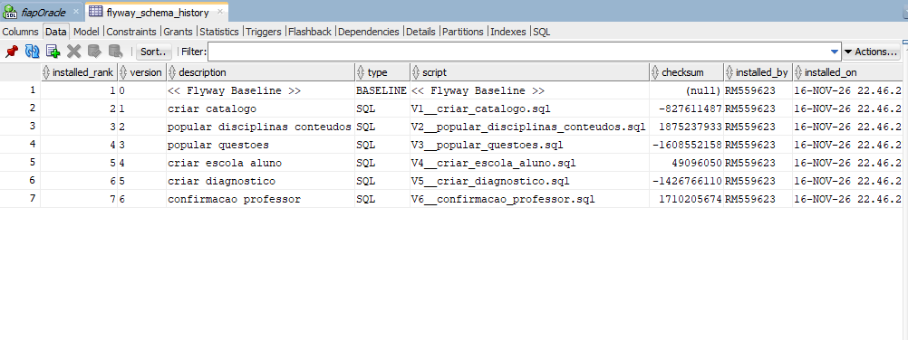

#### 2. Tabelas criadas no Oracle

As 9 tabelas com o prefixo `GS2627_1_` criadas pelas migrações, ao lado da `flyway_schema_history`.

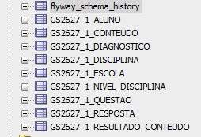

#### 3. Dados iniciais inseridos pelas migrações

Tabela `GS2627_1_DISCIPLINA` com as 2 disciplinas inseridas pela V2. As tabelas `2026_GS_` que aparecem na lista são de outro trabalho que já existia no mesmo esquema; é por causa delas que o Flyway usa *baseline* na versão 0.

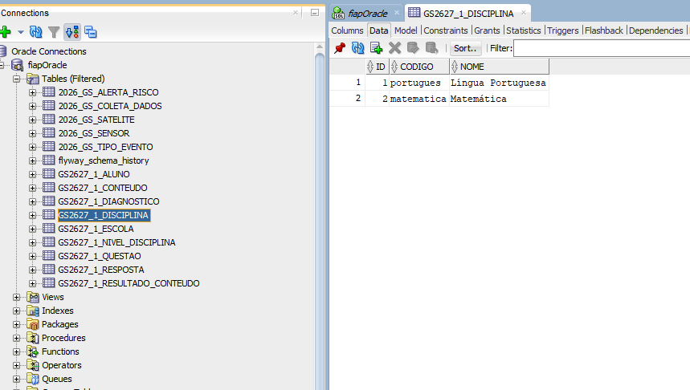

#### 4. Diagnóstico gravado no banco

Tabela `GS2627_1_DIAGNOSTICO` com o diagnóstico criado no [item 11](#11-diagnóstico-criado-201): aluno 1, 4º ano, data e hora da gravação e versão 2.0 do modelo.

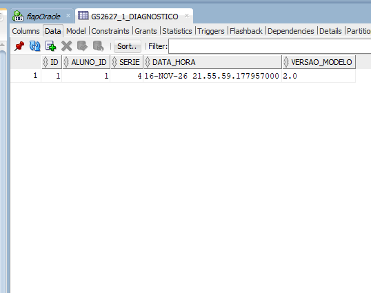

### Testes manuais (Insomnia)

#### 5. Health check

`GET /healthcheck` responde **200** com o texto `Teste de integridade da API AprendIA.`.

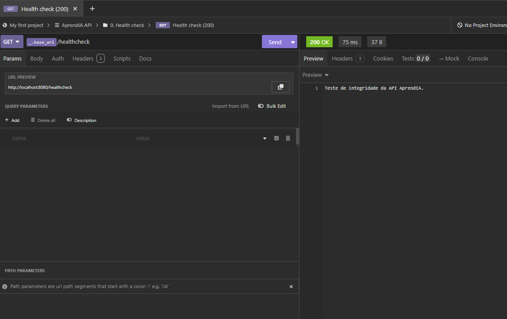

#### 6. Questionário da série

`GET /questionarios/3` responde **200** com as 24 questões do 3º ano, cada uma com o conteúdo e a disciplina, sem o gabarito.

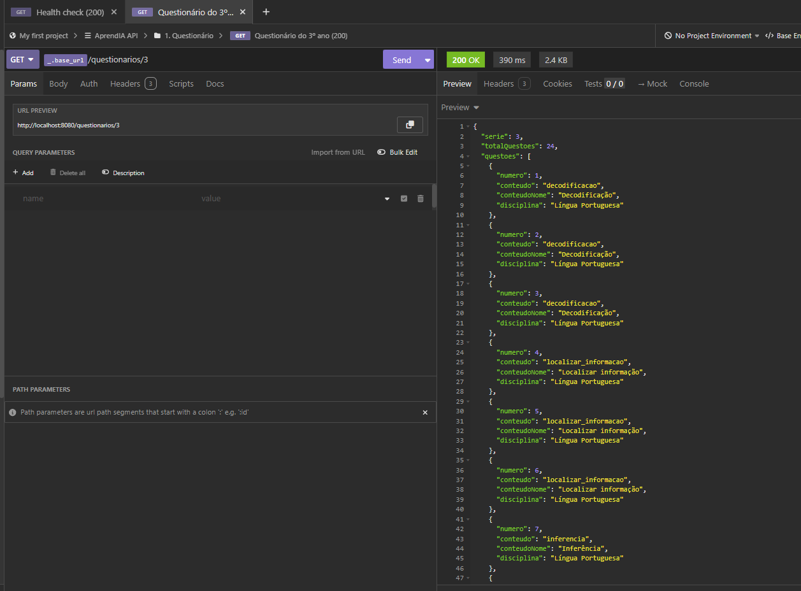

#### 7. Cadastro de escola

`POST /escolas` com `{"codigo": "E01", "nome": "EMEF Exemplo"}` responde **201 Created** com a escola gravada (id 1).

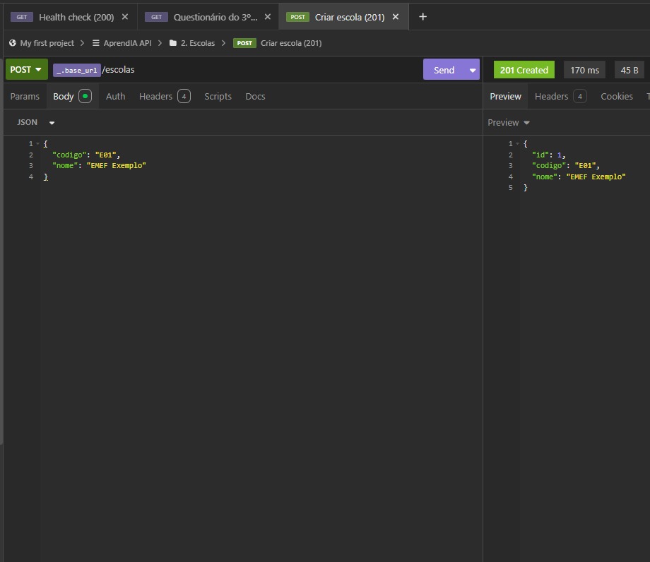

#### 8. Cadastro de aluno

`POST /alunos` cadastra o aluno `A03503` do 4º ano na escola criada e responde **201 Created**, com os dados da escola na resposta.

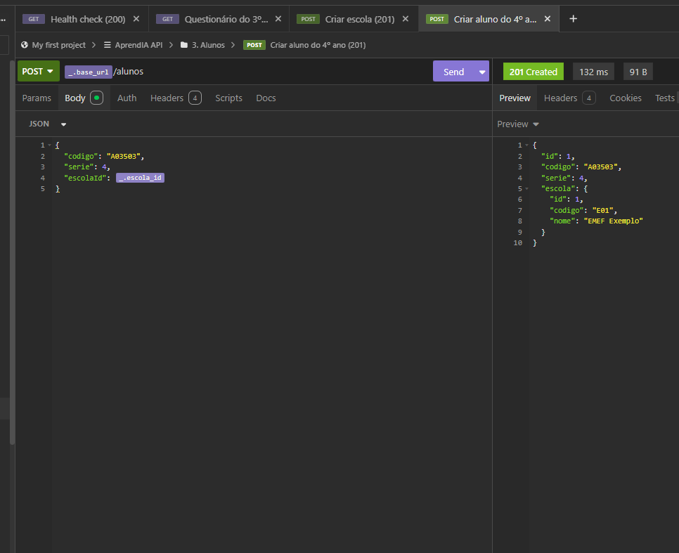

#### 9. Listagem paginada

`GET /escolas?page=0&size=1&sort=codigo,desc` responde **200** com uma página de 1 registro e os dados da paginação (`totalElements`, `totalPages`, `pageable`, `sort`).

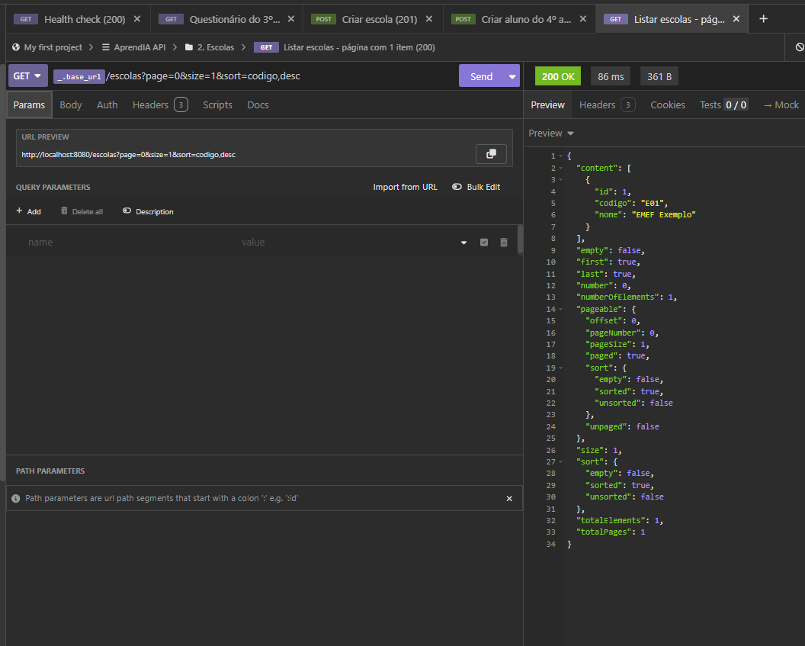

#### 10. Validação de dados (400)

`POST /alunos` com série 9 responde **400 Bad Request** no formato padrão de erro, com o campo inválido em `detalhes`.

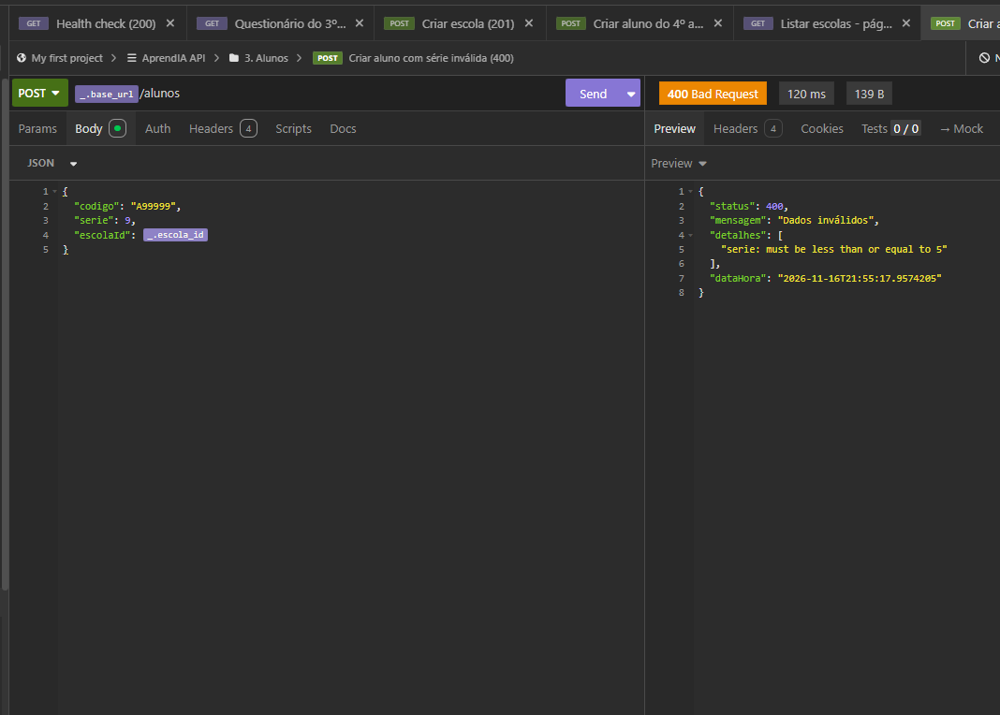

#### 11. Diagnóstico criado (201)

`POST /alunos/{id}/diagnosticos` com as 24 respostas do golden test A03503 responde **201 Created**: 4 lacunas encontradas, Língua Portuguesa "em desenvolvimento", Matemática "a confirmar" (geometria e grandezas e medidas ficam para o professor) e o resultado de cada conteúdo com acertos e probabilidade.

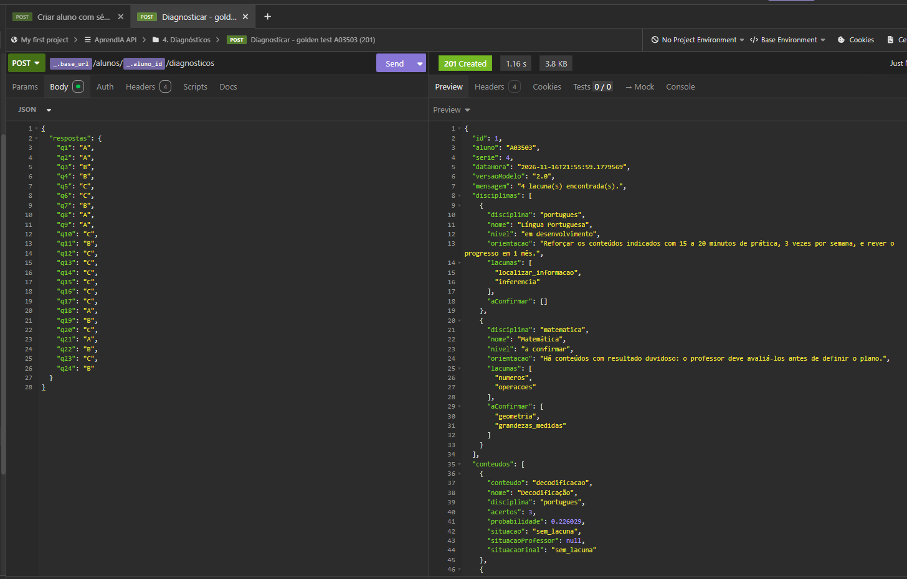

#### 12. Questionário inválido (400)

O mesmo questionário com `q1` = `"D"` responde **400** `Questionário inválido`, com o detalhe `q1: resposta inválida 'D'`. Nada é gravado.

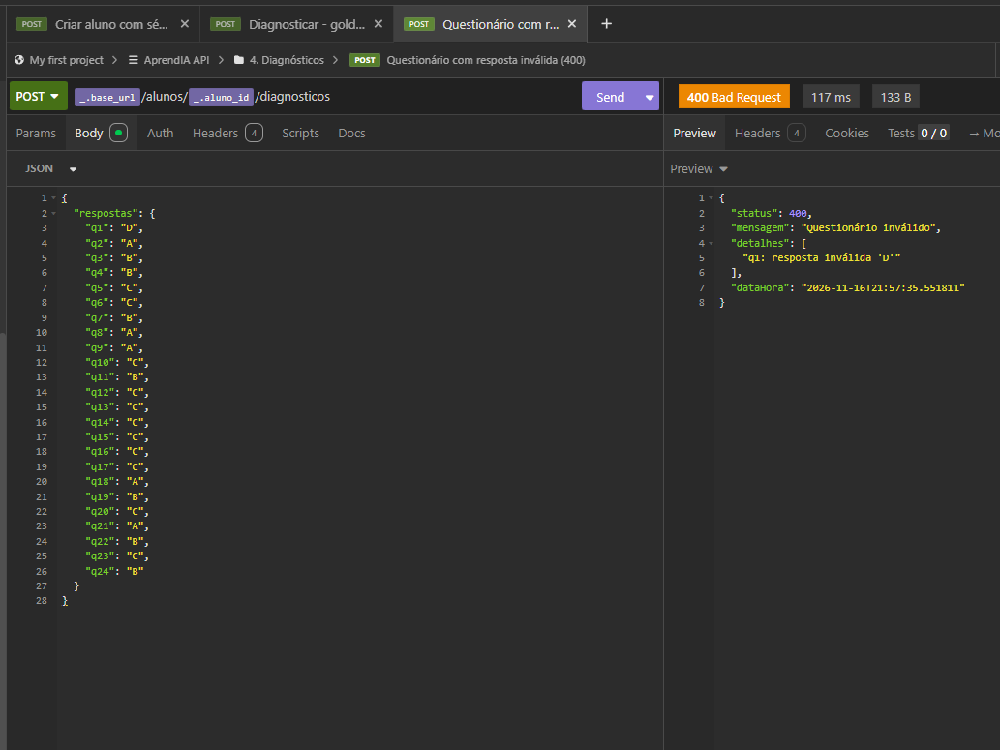

#### 13. Confirmação do professor

`PATCH /alunos/{id}/diagnosticos/{id}/conteudos/geometria` com `{"situacao": "lacuna"}` responde **200** com o diagnóstico atualizado: em geometria, a decisão do modelo (`a_confirmar`) continua gravada e `situacaoProfessor` e `situacaoFinal` passam a `lacuna`.

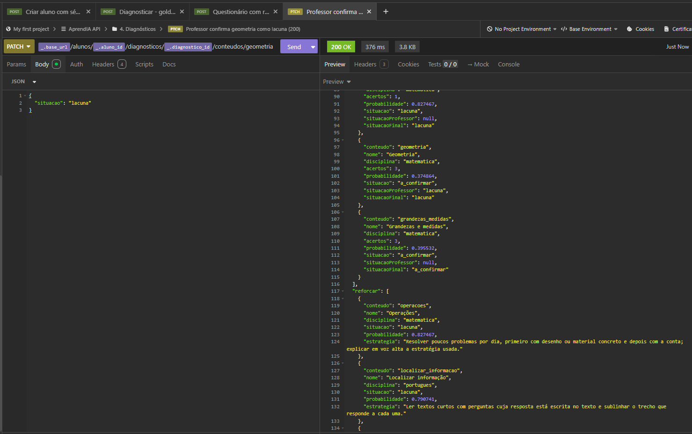

#### 14. Histórico do aluno

`GET /alunos/{id}/diagnosticos` responde **200** com o resumo do diagnóstico depois da confirmação: 5 lacunas, 1 conteúdo ainda a confirmar e Matemática recalculada para "abaixo do esperado".

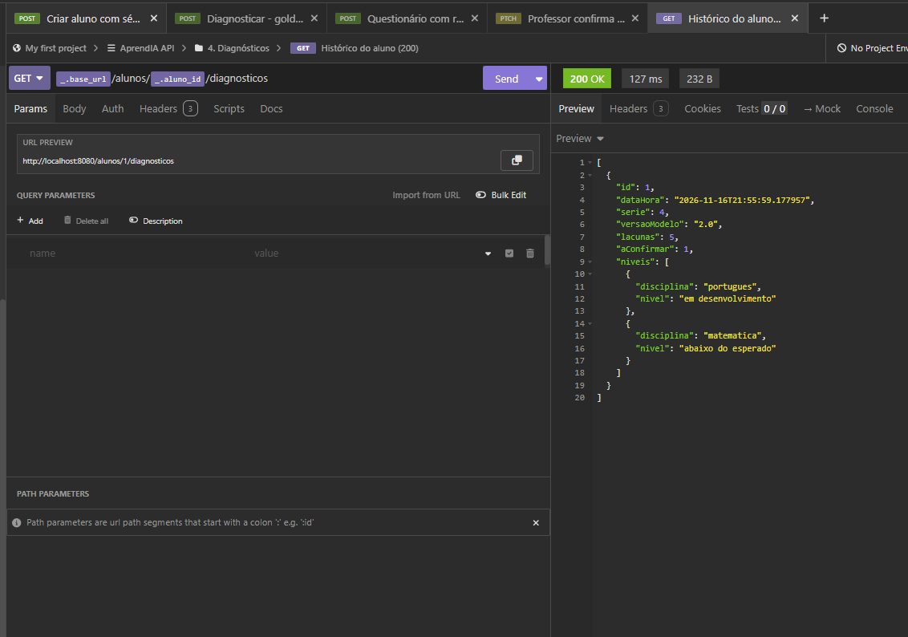

#### 15. Exclusão bloqueada (409)

`DELETE /escolas/{id}` de uma escola que tem alunos responde **409 Conflict** com a mensagem `A escola E01 tem alunos e não pode ser excluída`.

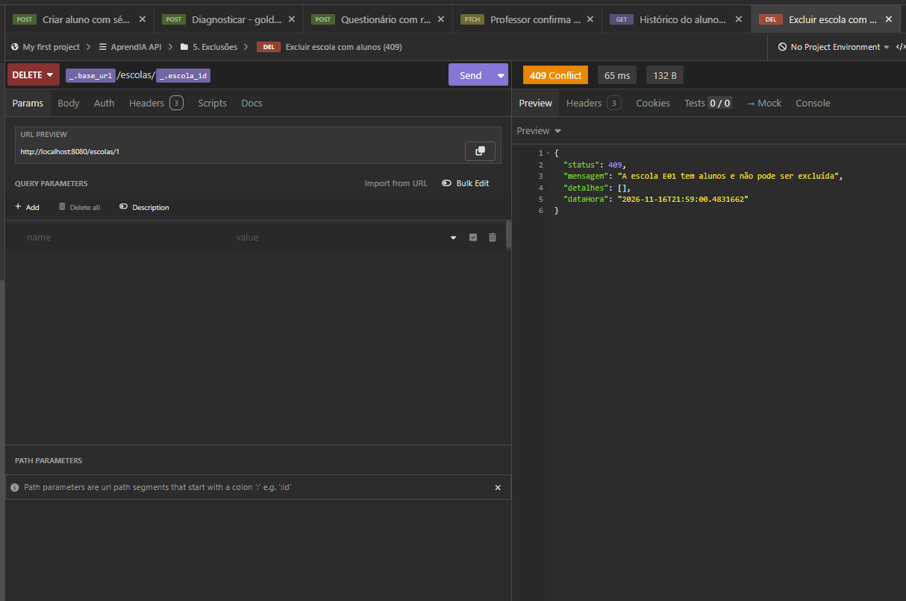
